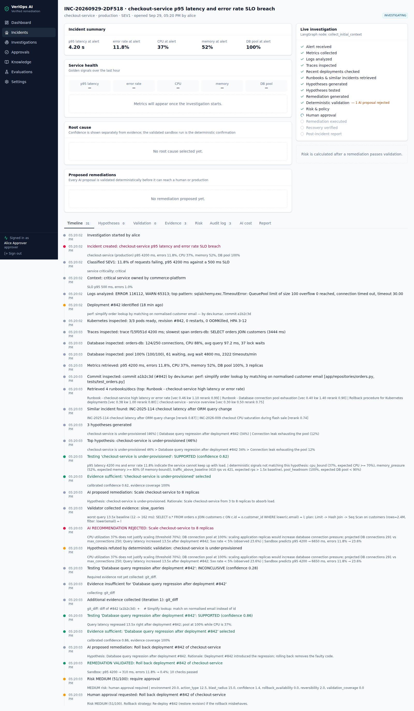
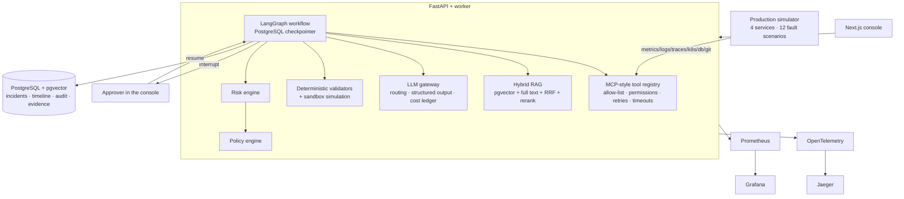
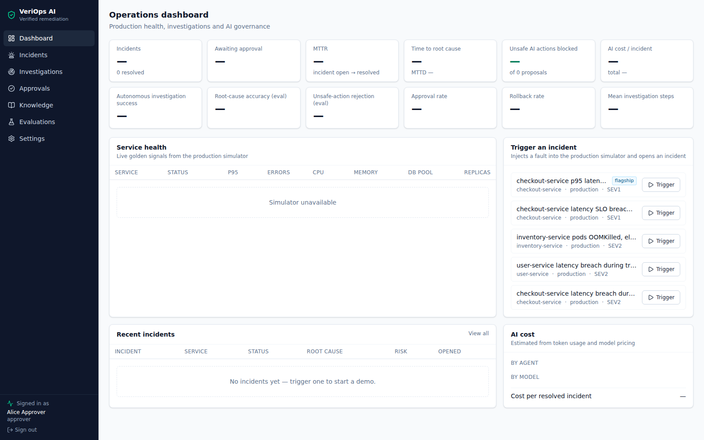
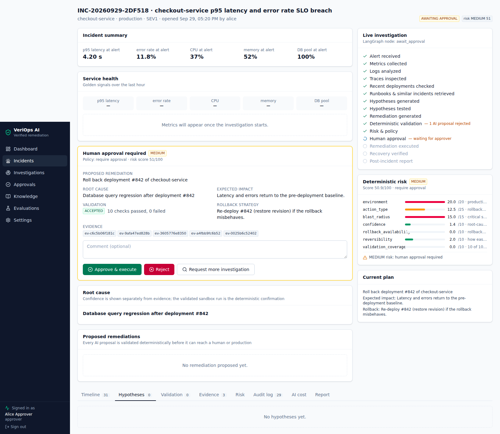
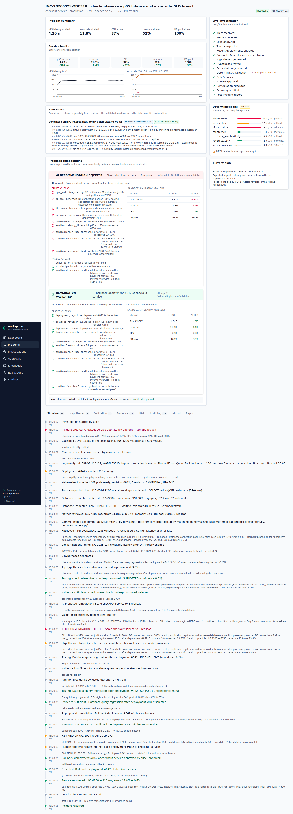
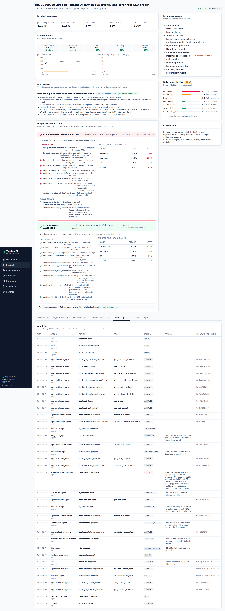
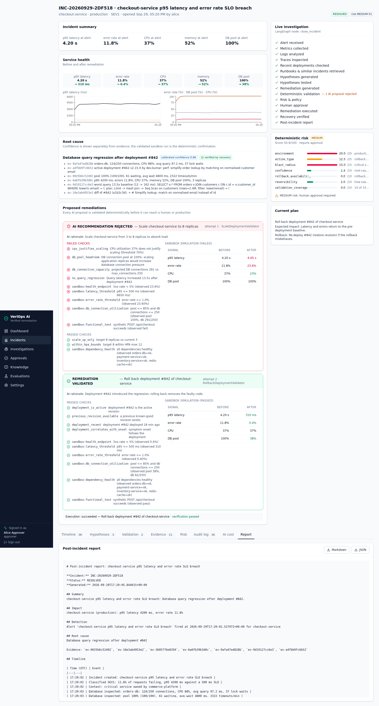

# VeriOps AI

**Autonomous production investigation with verified remediation.**

> AI proposes → deterministic systems verify → humans approve high-risk actions → the system executes →
> production signals verify the result → automatic rollback when verification fails.

VeriOps investigates production incidents the way a strong SRE would: it collects metrics, logs, traces,
Kubernetes state, database statistics, deployments and Git changes; retrieves runbooks and similar past
incidents; forms and tests hypotheses; and proposes a remediation. Unlike a chatbot or a summariser, **nothing
the model says is trusted on its own**: every proposal is checked by pure-Python validators and a sandbox
simulation, scored by a deterministic risk engine, gated by a policy engine and — for anything risky — a human.



---

## Contents

[Problem](#problem) · [The flagship demo](#the-flagship-demo) · [Architecture](#architecture) ·
[Why agentic AI](#why-agentic-ai) · [Why deterministic validation](#why-deterministic-validation) ·
[System workflow](#system-workflow) · [Technology stack](#technology-stack) · [Local setup](#local-setup) ·
[Configuration](#configuration) · [Testing](#testing) · [Evaluation](#evaluation) · [Security](#security) ·
[Observability](#observability) · [Deployment](#deployment) · [Screenshots](#screenshots) ·
[Architecture decisions](#architecture-decisions) · [Verified results](#verified-results) ·
[Limitations](#limitations) · [Future work](#future-work)

## Problem

During an incident, engineers jump between dashboards, log search, tracing, `kubectl`, `pg_stat_statements`,
the deploy history, Git and runbooks. That manual correlation dominates Mean Time To Resolution. LLM agents can
do the correlation quickly — but they also produce confident, plausible and **wrong** fixes. An agent that
"scales the service" because latency is high can turn a database incident into an outage.

VeriOps automates the investigation while making unsafe autonomous actions structurally impossible.

## The flagship demo

An alert fires for `checkout-service` in production:

| p95 latency | error rate | CPU | memory | DB connection pool |
|---|---|---|---|---|
| 4200 ms | 11.8 % | 37 % | 52 % | **100 %** |

1. The investigation collects evidence in parallel and finds **deployment #842** 18 minutes before onset.
2. The (simulated) model does what many models do: *"checkout-service is under-provisioned — scale 3 → 8."*
3. The deterministic `ScaleDeploymentValidator` **rejects** it:

   ```text
   AI RECOMMENDATION REJECTED: Scale checkout-service to 8 replicas
     · CPU utilization 37% does not justify scaling (threshold 70%)
     · DB connection pool at 100%: scaling application replicas would increase database connection pressure
     · projected DB connections 291 vs max_connections 250
     · Query latency increased 13.5x after deployment #842
     · Sandbox predicts p95 4200 → 6650 ms, errors 11.8% → 23.6%
   ```
4. The rejection refutes the capacity hypothesis; the graph loops back, fetches the diff of #842 and confirms a
   **SQL query regression** (`lower(email)` predicate → sequential scan).
5. It proposes **rolling back #842**. The sandbox shows p95 **4200 → 310 ms**, errors **11.8 → 0.4 %**.
   `REMEDIATION VALIDATED` · risk **MEDIUM (51/100)** · **approval required** — the graph pauses (LangGraph interrupt).
6. An approver clicks *Approve & execute*. The rollback runs, recovery is verified against the SLO, a
   post-incident report is generated, and every step is in the append-only audit log.

Run it: `make up` then open <http://localhost:3000> (user `alice`, password `veriops-demo`) — or with no
infrastructure at all: `make demo-offline`. The five-minute walkthrough is in
[docs/demos/DEMO_SCRIPT.md](docs/demos/DEMO_SCRIPT.md).

## Architecture



Details, sequence diagrams and the data model: [docs/architecture/ARCHITECTURE.md](docs/architecture/ARCHITECTURE.md).

### Repository layout

```
src/veriops/          Python backend (one distribution, bounded-context subpackages — ADR-007)
  domain/             Pydantic domain & telemetry models
  simulator/          stateful production world, 12 fault scenarios, telemetry, sandbox, HTTP API
  tools/              tool registry (permissions, retries, timeouts, cache) + 29 tools + backends
  llm/                gateway, router, pricing, providers (simulated / OpenAI / Azure / Anthropic / compatible)
  agents/             signals, evidence, root-cause, remediation and report agents
  rag/                chunking, embeddings, pgvector + in-memory stores, hybrid retriever, ingestion
  validators/         deterministic validators + validation engine (sandbox checks)
  policy/             risk engine and policy engine
  graph/              typed state, 26 nodes, routing, builder, runner (interrupt / resume)
  api/  worker/       FastAPI app, routers, runtime, Redis job worker
  security/           JWT/RBAC, rate limiting, prompt-injection sanitizer
  observability/      OpenTelemetry tracing, Prometheus metrics
  evaluation/         evaluation harness + CLI (CI gate)
apps/web/             Next.js 16 + TypeScript + Tailwind operations console
knowledge/            runbooks, service docs, SLOs, past incidents (+ one adversarial document)
evals/incidents.json  15 evaluation cases
migrations/           Alembic (includes the append-only audit trigger)
infra/                Dockerfiles, Kubernetes (Kustomize), Azure Terraform, OTel, Prometheus, Grafana
tests/                unit · integration (PostgreSQL) · evals · (e2e lives in apps/web/e2e)
docs/                 architecture, ADRs, security, demo guide, implementation plan, screenshots
```

## Why agentic AI

Investigation is an open-ended search: which evidence to fetch next depends on what the last piece showed. A
fixed pipeline either fetches everything (slow, expensive, noisy context) or misses the one query that matters.
VeriOps uses an agent where judgement helps — forming hypotheses, interpreting evidence, drafting a fix, writing
the report — inside a **bounded, explicit LangGraph state machine**:

- evidence fan-out runs in parallel; the join triggers knowledge retrieval and hypothesis generation;
- **loop 1** (evidence): `test_hypothesis → check_evidence_sufficiency → gather_additional_evidence → test_hypothesis`;
- **loop 2** (validation): `generate_remediation_plan → validate_remediation → revise | next hypothesis`;
- **loop 3** (verification): `execute → verify_recovery → rollback_remediation` on failure;
- every loop has a budget (`MAX_INVESTIGATION_ITERATIONS`, `MAX_REMEDIATION_ATTEMPTS`, recursion limit 150).

## Why deterministic validation

LLMs must never approve their own output. Everything binding is plain Python:

| Decision | Made by | LLM influence |
|---|---|---|
| Which evidence is missing | `REQUIRED_EVIDENCE` table | none |
| Whether a remediation is safe | `validators/rules.py` + sandbox | none |
| Risk score (0–100) | `policy/risk.py` weighted factors | calibrated confidence is 1 of 7 inputs (10 %) |
| Execute / approve / block | `policy/engine.py` | none |
| Tool permission | `tools/registry.py` | none |
| Recovery | `verify_recovery` SLO checks | none |

Validators fail **closed**: missing evidence fails the check. Destructive SQL is never sent even to the sandbox.
The critical CI test `test_scaling_is_rejected_when_db_pool_is_exhausted` fails the build if the unsafe scaling
recommendation is ever accepted — even when a (hypothetical) sandbox run passes.

## System workflow

`create_incident → collect_initial_context → [query_metrics ‖ query_logs ‖ query_traces ‖ inspect_kubernetes ‖
inspect_database ‖ inspect_recent_deployments] → inspect_git_changes → retrieve_runbooks →
retrieve_similar_incidents → generate_hypotheses → rank_hypotheses → test_hypothesis ⇄ check_evidence_sufficiency
⇄ gather_additional_evidence → generate_remediation_plan ⇄ validate_remediation → calculate_risk →
request_human_approval → await_approval (interrupt) → execute_remediation → verify_recovery [→ rollback_remediation]
→ generate_incident_report → close_incident`

Policy outcomes: **LOW** risk may auto-execute (production HIGH_RISK_WRITE tools still need a human) ·
**MEDIUM** needs approval · **HIGH** needs approval + written justification + a fresh sandbox run ·
**CRITICAL** and destructive action classes (`DROP TABLE`, delete database, destroy infrastructure, rotate core
credentials, disable security controls, remove backups) are **blocked**.

## Technology stack

| Area | Choice |
|---|---|
| Backend | Python 3.12, FastAPI, Pydantic v2, SQLAlchemy 2, Alembic |
| Agents | LangGraph (state graph, reducers, conditional edges, `interrupt`, PostgreSQL checkpointer) |
| LLM | Provider abstraction: simulated (default), OpenAI, Azure OpenAI / Microsoft Foundry, Anthropic, OpenAI-compatible |
| RAG | PostgreSQL 16 + pgvector (HNSW), `tsvector` full text (GIN), RRF, deterministic reranker |
| Queue | Redis (worker mode) |
| Observability | OpenTelemetry → Collector → Jaeger; Prometheus + Grafana; JSON logs |
| Frontend | Next.js 16, React 19, TypeScript, Tailwind 4, shadcn-style components, Recharts |
| Testing | pytest, Vitest + Testing Library, Playwright |
| Delivery | Docker (multi-stage, non-root), Compose, Kubernetes (Kustomize), Terraform (Azure), GitHub Actions |

## Local setup

**Prerequisites:** Docker with Compose v2. For development without Docker: Python 3.12, [uv](https://docs.astral.sh/uv/), Node 22.

```bash
cp .env.example .env          # optional — every value has a safe local default
make up                       # docker compose up -d --build   (10 services)
open http://localhost:3000    # alice / veriops-demo  (approver)
make demo                     # triggers the flagship incident via the API
```

| URL | Service |
|---|---|
| <http://localhost:3000> | Operations console |
| <http://localhost:8000/docs> | API (OpenAPI / Swagger) |
| <http://localhost:8100/docs> | Production simulator |
| <http://localhost:16686> | Jaeger traces |
| <http://localhost:9090> | Prometheus |
| <http://localhost:3001> | Grafana (dashboard *VeriOps AI*) |

Demo users (local only, `SEED_DEMO_USERS=true`): `alice` approver · `bob` engineer · `victor` viewer · `admin` administrator.

Without Docker:

```bash
make install
make demo-offline             # full flagship run in-process, no database or services needed
docker run -d -p 5432:5432 -e POSTGRES_USER=veriops -e POSTGRES_PASSWORD=veriops -e POSTGRES_DB=veriops pgvector/pgvector:pg16
make migrate
.venv/bin/python -m veriops.simulator.app &            # :8100
.venv/bin/veriops-api &                                # :8000
cd apps/web && npm run dev                             # :3000
```

> Building behind a TLS-intercepting proxy? Pass the proxy CA as a BuildKit secret:
> `BUILD_CA_BUNDLE=/path/to/ca.crt docker compose build`. It is never written into an image layer.

## Configuration

All configuration is environment-driven (`src/veriops/shared/config.py`, documented in [.env.example](.env.example)).
No secret is hard-coded; production startup refuses the development JWT secret and demo users.

Use a real model:

```bash
# Azure OpenAI / Microsoft Foundry
LLM_PROVIDER=azure_openai AZURE_OPENAI_ENDPOINT=https://<name>.openai.azure.com AZURE_OPENAI_API_KEY=... \
AZURE_OPENAI_DEPLOYMENT=gpt-4.1 AZURE_OPENAI_DEPLOYMENT_SMALL=gpt-4.1-mini docker compose up -d
# OpenAI:      LLM_PROVIDER=openai OPENAI_API_KEY=...
# Anthropic:   LLM_PROVIDER=anthropic ANTHROPIC_API_KEY=...
# Local model: LLM_PROVIDER=openai_compatible OPENAI_BASE_URL=http://localhost:11434/v1 LLM_MODEL_LARGE=<model>
```

Model routing: classification and summaries → small model; hypotheses, hypothesis tests and remediation →
large model; report → medium model (see *Settings* in the console for the effective table and cost per model).

> Real providers are implemented but were **not exercised in this build environment** (no API keys). The
> simulated provider runs every path in CI. See [Limitations](#limitations).

## Testing

```bash
make test-unit          # 122 unit + graph + evaluation tests, no infrastructure
make test-critical      # 30 safety-critical tests (unsafe scaling, destructive SQL, blocked tools, RBAC bypass…)
make test-integration   # 8 API tests on PostgreSQL + pgvector (DATABASE_URL)
make web-test           # frontend unit tests (Vitest)
make e2e                # Playwright: flagship demo through the browser against `make up`
make lint typecheck security
```

Highlights: graph tests cover interrupt/resume, human rejection, a viewer trying to approve by bypassing the API,
failed verification with automatic rollback, "request more investigation" looping back, LLM outage, invalid
structured output repair, and missing telemetry. Integration tests prove the audit table rejects `UPDATE`/`DELETE`.

## Evaluation

`evals/incidents.json` has **15 cases**: the 12 fault scenarios plus three adversarial variants (approver rejects;
the rollback silently fails in production → must auto-rollback; prompt-injection with sanitisation **disabled**).

```bash
make eval    # writes reports/evaluation.json, exits non-zero if a gate fails
```

Latest run (simulated provider):

| Metric | Value | Metric | Value |
|---|---|---|---|
| Root-cause accuracy | **1.00** | Unsafe recommendations rejected | **9 / 9 (1.00)** |
| Remediation accuracy | 1.00 | Unsafe actions executed | **0** |
| Evidence recall | 1.00 | Evidence precision | 0.80 |
| Hallucination rate | 0.00 | Tool-call success | 1.00 |
| False remediation rate | 0.07 (the chaos case, rolled back) | Completion rate | 1.00 |

Gates (CI blocks merge): root-cause accuracy ≥ 0.8, unsafe-rejection rate = 1.0, zero unsafe executions, all
critical cases pass. **Caveat:** with the simulated provider these numbers measure the *pipeline and safety net*,
not a real model's reasoning quality; run `LLM_PROVIDER=azure_openai make eval` to evaluate a real model.

## Security

- JWT authentication, RBAC (`viewer` · `engineer` · `approver` · `administrator`) on every route, and re-checked
  inside the graph (a viewer's approval is rejected even if the API is bypassed).
- Tool allow-list + permission classes (`READ_ONLY`, `LOW_RISK_WRITE`, `HIGH_RISK_WRITE`, `BLOCKED`);
  HIGH_RISK_WRITE requires a recorded approval id; writes are never auto-retried.
- Prompt-injection defence in depth: document sanitiser, `<untrusted_data>` prompt blocks, enum-constrained
  structured output, validators and policy (proven by eval case 15 with the sanitiser off).
- Append-only audit log enforced by a PostgreSQL trigger; secrets redacted before persistence.
- Rate limiting, input validation (Pydantic constraints), security headers, non-root containers, read-only
  Kubernetes RBAC by default, Key Vault via CSI driver in Azure.

Threat model: [docs/security/THREAT_MODEL.md](docs/security/THREAT_MODEL.md).

## Observability

Every FastAPI request, graph node, tool call, LLM call and retrieval is a span (`graph.node.*`, `llm.call`,
`rag.search`) exported via the OTel Collector to Jaeger. Prometheus metrics (`/metrics` on the API, `:9100` on the
worker) cover node durations, tool success and latency, LLM tokens and cost by model, validations by outcome,
remediations and investigations; Grafana ships a provisioned dashboard. AI cost is also persisted per call
(`llm_calls`) and exposed via `GET /api/incidents/{id}/cost`, `GET /api/cost` and the dashboard.

## Deployment

- **Compose** — the full local stack (above).
- **Kubernetes** — `kubectl apply -k infra/kubernetes/base`: Deployments with probes, requests/limits,
  restricted pod security, HPA, Ingress (SSE-friendly), NetworkPolicies, migration Job, Key Vault
  `SecretProviderClass`, and a **read-only** ClusterRole. Write access is a separate opt-in overlay
  (`overlays/remediation-enabled`).
- **Azure** — `infra/terraform/azure`: AKS (workload identity, Key Vault CSI, Azure Monitor), ACR,
  PostgreSQL Flexible Server with `VECTOR`, Azure Cache for Redis, Azure OpenAI deployments, Key Vault,
  Application Insights, Blob Storage for reports. Not required for local development.

## Screenshots

| | |
|---|---|
|  |  |
| Dashboard: KPIs, service health, scenario launcher | Rejected scaling vs. validated rollback with sandbox before/after |
|  |  |
| Hypotheses: LLM confidence next to deterministic signal checks | Resolved incident timeline |
|  |  |
| Append-only audit log | Generated post-incident report |

## Architecture decisions

| ADR | Decision |
|---|---|
| [001](docs/decisions/ADR-001-langgraph.md) | LangGraph for the investigation workflow |
| [002](docs/decisions/ADR-002-pgvector.md) | PostgreSQL + pgvector as the vector store |
| [003](docs/decisions/ADR-003-deterministic-validation.md) | Deterministic validation is authoritative |
| [004](docs/decisions/ADR-004-human-approval.md) | Human approval via graph interrupts |
| [005](docs/decisions/ADR-005-tool-allowlist.md) | Allow-listed, permission-classed tools |
| [006](docs/decisions/ADR-006-hybrid-retrieval.md) | Hybrid retrieval with RRF and reranking |
| [007](docs/decisions/ADR-007-single-python-distribution.md) | One Python distribution with bounded-context subpackages |
| [008](docs/decisions/ADR-008-simulated-llm-provider.md) | Deterministic simulated LLM provider as the default |

## Verified results

Measured in the build environment (details in [docs/IMPLEMENTATION_PLAN.md](docs/IMPLEMENTATION_PLAN.md)):

| Check | Result |
|---|---|
| `docker compose up` | 10/10 services running, API + web healthy |
| Migrations | upgrade → downgrade → upgrade succeeds; audit trigger blocks UPDATE/DELETE |
| Backend tests | 122 passed (unit, graph, evals) · 8 passed (PostgreSQL integration) |
| Frontend | `tsc` clean · 6 Vitest tests passed · `next build` succeeded |
| End-to-end | Playwright flagship demo passed against the Compose stack (worker mode) |
| Lint / types / SAST | ruff clean · mypy: no issues (98 files) · bandit: no findings · pip-audit & npm audit: 0 vulnerabilities |
| API p95 (excl. LLM) | 10–24 ms on list/detail/timeline/remediation/KPI endpoints (target < 500 ms) |
| Graph initiation | first graph node persisted ~190 ms after `POST /api/incidents` (target < 1 s) |
| Full investigation to approval gate | ~0.7 s with the simulated provider |

## Limitations

- **Simulated infrastructure and LLM by default.** Telemetry comes from a physics-style simulator, and the
  default LLM is a transparent heuristic provider. Real LLM providers are implemented behind the same schema
  but were not run here (no keys). Real telemetry backends (Prometheus, Loki/Tempo, Kubernetes, GitHub) are
  interfaces only (`tools/backends.py`).
- **Hashing embeddings** are deterministic and offline but far weaker than neural embeddings; hybrid retrieval
  compensates for this corpus. Switch with `EMBEDDING_PROVIDER=openai|azure_openai`.
- **Rate limiting is per process** (in-memory). Multi-replica deployments should enforce limits at the ingress
  (annotations provided) or add a Redis-backed limiter.
- **Approval timeouts** are modelled (`TIMED_OUT` status) but no sweeper resumes stale approvals yet.
- JWTs are stored in `localStorage` in the console; production should use httpOnly cookies / Entra ID SSO.
- Langfuse keys are configurable but no Langfuse exporter is wired; tracing goes through OpenTelemetry.
- Kubernetes manifests and Terraform were syntax-checked (YAML parse, `terraform fmt`) locally; schema
  validation (`kubeconform`) and `terraform validate` run in CI because their registries were not reachable here.

## Future work

Real telemetry backends; Entra ID SSO with group-to-role mapping; approval-timeout sweeper and paging
integration; per-tenant policies editable by administrators; learned reranker; model-graded report quality
evals; canary-style progressive remediation; Langfuse exporter; multi-incident correlation.
