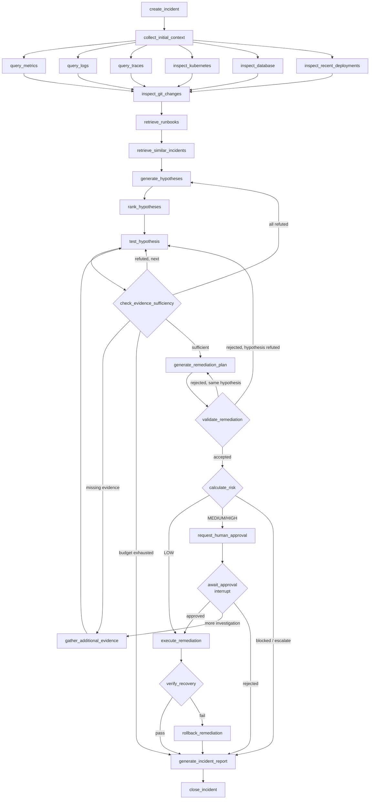
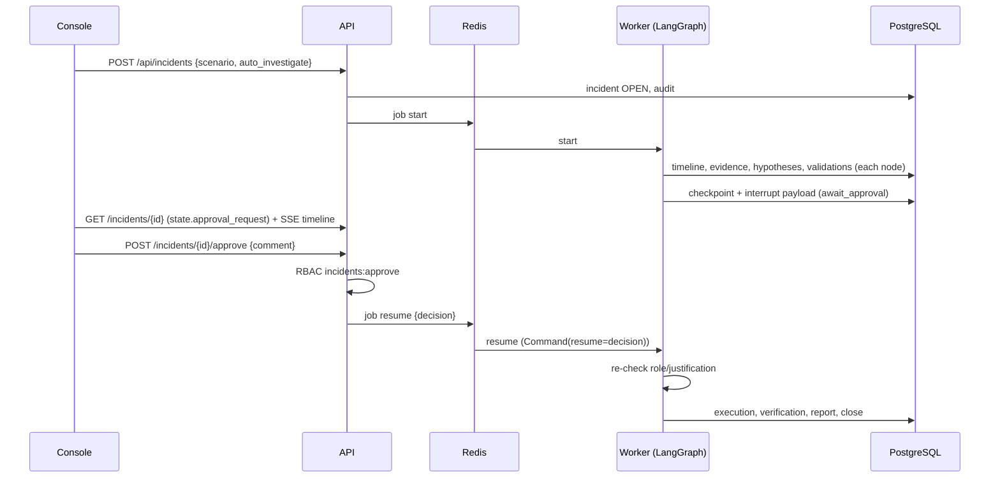

# VeriOps AI — Architecture

## 1. Components

| Component | Code | Responsibility |
|---|---|---|
| Production simulator | `simulator/` | Stateful model of 4 services: deployments, config, replicas, active fault, metric history. Renders telemetry and applies actions with plausible effects; sandbox runs on a deep copy. |
| Tool registry | `tools/` | 29 MCP-style tools, permission classes, input validation, retries, timeouts, cache, observers. |
| LLM gateway | `llm/` | Task → tier → model routing, prompts with `<untrusted_data>` blocks, schema validation + repair, bounded retries, response cache, cost ledger. |
| Agents | `agents/` | Signal extraction (deterministic), Evidence Agent, Root Cause Agent, Remediation Agent, Report Agent. |
| RAG | `rag/` | Front-matter parsing, chunking, embeddings, pgvector/in-memory stores, hybrid retriever. |
| Validation | `validators/` | One validator per action class + sandbox tests → `ValidationResult`. |
| Risk & policy | `policy/` | Weighted 0–100 risk score and policy decision. |
| Workflow | `graph/` | Typed state, 26 nodes, deterministic routers, runner with interrupt/resume. |
| API | `api/` | REST + SSE, JWT/RBAC, rate limits, read models, job submission. |
| Worker | `worker/` | Consumes start/resume jobs from Redis; shares the PostgreSQL checkpointer with the API. |
| Console | `apps/web/` | Next.js operations UI. |

## 2. Investigation graph

Budgets: `MAX_INVESTIGATION_ITERATIONS` (evidence loop), `MAX_REMEDIATION_ATTEMPTS` per hypothesis (×3 overall),
two hypothesis generations, LangGraph recursion limit 150. Every node is wrapped by `instrumented()` which opens
a span, records duration and an `agent_runs` row, updates `incidents.current_node`, and converts unexpected
exceptions into a `NodeError` that routes to the report (the graph never dies silently).

## 3. Approval sequence

## 4. Data model (PostgreSQL)

| Table | Purpose |
|---|---|
| `users`, `roles`, `services` | identity, RBAC permissions, service catalog (criticality, SLOs) |
| `incidents` | status, current node, root cause, risk, approval status, report JSON |
| `incident_events` | timeline (ordered by `seq`, streamed via SSE) |
| `evidence_items`, `metrics_snapshots`, `log_evidence`, `trace_evidence` | evidence with ids referenced by conclusions |
| `hypotheses`, `hypothesis_tests` | proposals and test results (LLM confidence, coverage, calibrated confidence, signal checks) |
| `remediation_plans`, `validation_runs`, `approvals`, `executions` | the remediation lifecycle |
| `audit_events` | append-only (trigger blocks UPDATE/DELETE); secrets redacted |
| `agent_runs`, `llm_calls`, `tool_calls` | per-step telemetry, token usage and cost |
| `knowledge_documents`, `document_chunks` | RAG corpus (`vector(384)` HNSW + generated `tsvector` GIN) |
| `evaluation_runs` | evaluation metrics and per-case results |
| `checkpoint*` (LangGraph) | durable graph state |

## 5. Memory separation

| Memory | Where | Lifetime |
|---|---|---|
| Workflow state | LangGraph checkpoint (`InvestigationState`) | one investigation |
| Incident memory | incident tables (timeline, evidence, decisions, report) | permanent, queryable |
| Long-term operational knowledge | `knowledge_documents` / `document_chunks` (runbooks, past incident reports; new reports can be ingested via `POST /api/knowledge/documents`) | permanent, retrievable |

There is no chat history. Agents receive a structured context built from state for each task.

## 6. Confidence calibration

For each tested hypothesis the UI shows three separate things: the LLM's prior probability, a calibrated
confidence (`llm_confidence × (0.6 + 0.4 × evidence_coverage)`, capped at 0.95), and a list of deterministic
signal checks with observed vs. expected values. Nothing is shown as certain; the "verified by recovery" badge
appears only after production verification passed.

## 7. Performance targets

| Target | Measured (Compose, simulated LLM) |
|---|---|
| API p95 < 500 ms excluding LLM | 10–24 ms |
| Incident graph initiation < 1 s | ~0.19 s to first persisted node |
| Dashboard load < 2 s locally | static shell served in < 10 ms; data endpoints ≤ 16 ms p95 |
| Tool timeout configurable | `TOOL_TIMEOUT_SECONDS` (default 10 s) |
